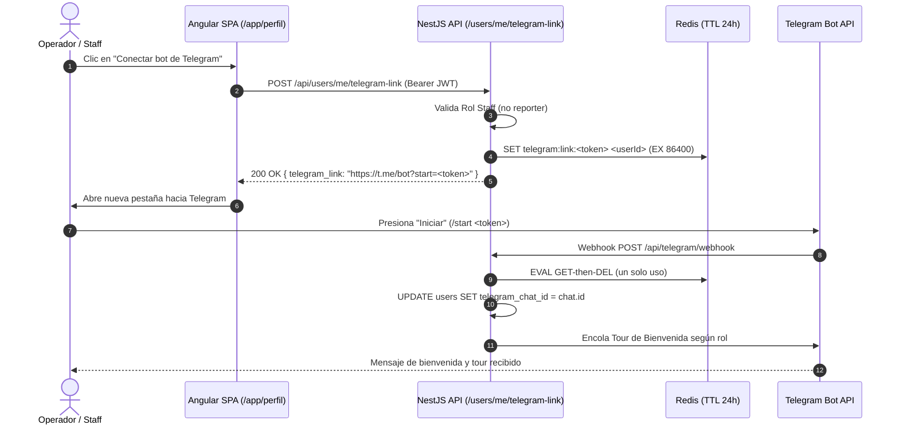

# Design: Formulario de Usuarios con Departamentos y Vinculación Híbrida de Telegram

## Contexto y Arquitectura

Esta iniciativa concluye el ciclo de vida de incorporación de personal interno (Onboarding Staff F7) cerrando la brecha identificada entre el backend y la aplicación Angular:
1. El backend ya implementó en `sc-436` la persistencia de `users.telegram_chat_id`, las invariantes de `organization_id + department_id` en `UsersService.adminCreate`, el retorno de `departments[]` en `GET /api/users/form-data`, y la emisión de tokens en Redis (`TelegramLinkService`).
2. El frontend actual carece de la UI reactiva para departamentos y no provee un mecanismo para generar o renovar tokens de Telegram de manera segura y autenticada.

---

## Decisiones de Diseño

### D1: Filtrado Reactivo de Departamentos en Angular Signals
- **Contexto**: Un municipio u organización puede tener decenas de departamentos. Si se mostraran todos en un `<select>` plano, el usuario podría asignar un departamento de Guayaquil a la organización de Santa Elena, provocando rechazo 400 en el backend.
- **Decisión**: Usar un `computed()` signal en `NewUserFormComponent`:
  ```typescript
  readonly filteredDepartments = computed<ReadonlyArray<Department>>(() => {
    const orgId = this.formData().organizationId;
    if (!orgId) return [];
    return this.departments().filter((dept) => dept.organizationId === orgId);
  });
  ```
- **Consecuencias**: El `<select>` de departamento permanece deshabilitado hasta que se elija una organización. Al cambiar de organización, un efecto o handler reinicia `departmentId = null`.
- **Alternativas Rechazadas**:
  - *Filtrar vía llamada HTTP adicional `GET /api/departments?org=...`*: Innecesario. `getFormData()` ya carga todos los departamentos del tenant en una sola llamada inicial liviana.

### D2: Manejo de Roles Globales vs. Seccionales en la Vista
- **Contexto**: `master` y `operador_sistema` son roles globales del sistema sin pertenencia a organización ni departamento. `admin_org` y `operador_org` son roles sectoriales estrictos.
- **Decisión**:
  - Definir constantes claras en `user.interface.ts`:
    ```typescript
    export const SECTIONAL_ROLES = ['admin_org', 'operador_org'] as const;
    export const GLOBAL_ROLES = ['master', 'operador_sistema'] as const;
    ```
  - En la vista, si el rol seleccionado es global, la tarjeta Sección 3 ("Asignación de Entidad") muestra un mensaje informativo sutil indicando que el rol opera a nivel nacional/global y deshabilita los inputs, garantizando que el payload envíe `null`.
- **Consecuencias**: Cero ambigüedad para el administrador. Se evitan envíos accidentales de IDs de organización.
- **Alternativas Rechazadas**:
  - *Eliminar la sección del DOM con `@if`*: Puede provocar saltos de layout bruscos en la grilla de dos columnas. Deshabilitarla con mensaje informativo mantiene la estabilidad visual del formulario.

### D3: Endpoint Quirúrgico Autenticado `POST /api/users/me/telegram-link`
- **Contexto**: Los enlaces de Telegram emitidos por correo tienen 24h de TTL. Para que un usuario activo o con enlace expirado pueda vincularse, se necesita emitir un token fresco sin intervención administrativa.
- **Decisión**: Exponer `POST /api/users/me/telegram-link` en `UsersController`:
  - Protegido por `JwtAuthGuard`.
  - Comprueba que el usuario no sea `reporter` (ciudadano).
  - Llama directamente a `telegramLinkService.issueFor(req.user.userId)` y compone la URL canónica `telegramLinkService.composeDeepLink(token)`.
  - Retorna `{ telegram_link: string }`.
- **Consecuencias**: Se reutiliza al 100% la lógica criptográfica y el almacenamiento en Redis ya probados en `sc-436`.
- **Alternativas Rechazadas**:
  - *Incluir el token en `GET /api/invitations/preview`*: Inseguro. La ruta de preview es pública e indexable, lo que permitiría robo o vinculación indebida de identidad previa a la creación de credenciales.

### D4: Tarjeta Self-Service en `profile-action-cards.component.ts`
- **Contexto**: El perfil de usuario (`/app/perfil`) ya cuenta con tarjetas de acción para contraseña, zonas y soporte.
- **Decisión**: Incorporar una 4ta tarjeta: **"Notificaciones Telegram"**:
  - Lee el estado del usuario logueado (`UserService.getCurrentUser()`). Si `telegram_chat_id` existe, muestra badge de confirmación.
  - Si no está vinculado, un botón "Conectar bot de Telegram" llama a `POST /api/users/me/telegram-link` y abre la URL en una nueva pestaña (`window.open(link, '_blank')`).
- **Consecuencias**: Experiencia fluida, moderna y 100% controlada por el usuario.
- **Alternativas Rechazadas**:
  - *Forzar modal intrusivo al iniciar sesión*: Interrumpe el flujo de trabajo del operador en situaciones de emergencia. La tarjeta en perfil y un banner descartable opcional son más respetuosos.

---

## Diagrama de Secuencia — Vinculación Híbrida en Perfil


